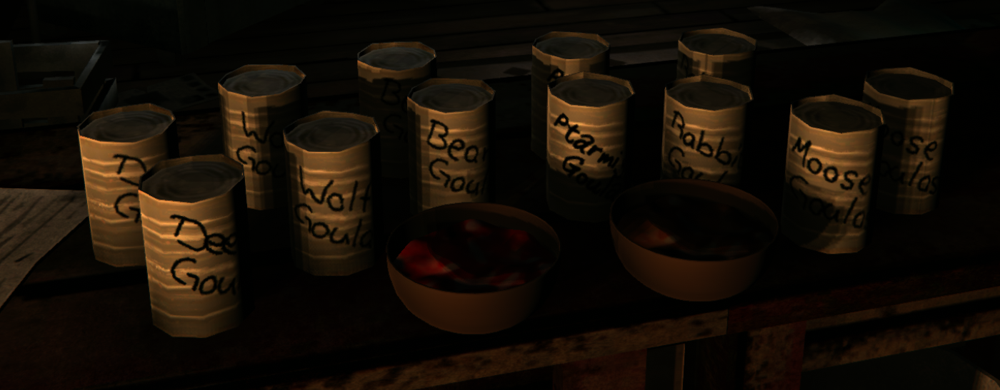

# Goulash
Adds goulash to the Long Dark made from Venison based on the <a href="https://github.com/ds5678/Food-Pack">food-pack</a> by <a href="https://github.com/ds5678">ds5678</a>  
  
  
  
Compatible with The Long Dark 2.59 and 2.60 (Goulash 1.3.1 and newer).  
  
## Installation:  
### Dependencies:  
#### NEEDS THE DLC  
1. Install MelonLoader (tested with v0.7.2) with the installer from its [releases](https://github.com/LavaGang/MelonLoader/releases)  
2. Download the latest version of `ModSettings.dll` in its [latest release](https://github.com/DigitalzombieTLD/ModSettings/releases/latest/download/ModSettings.dll)  
3. Download the latest version of `ModComponent.dll` in its [latest release](https://github.com/dommrogers/ModComponent/releases/latest/download/ModComponent.dll)  
   ModComponent 7 already contains GearSpawner, LocalizationUtilities and CraftingRevisions: remove old separate `GearSpawner.dll`, `LocalizationUtilities.dll` and `CraftingRevisions.dll` from the `Mods` folder.  
4. Move all downloaded `.dll` files into the `Mods` folder in your TLD install directory.
### Main Mod:  
1. Download the latest `goulash.modcomponent` from [here](https://github.com/renpre98/Goulash/releases/latest/download/goulash.modcomponent)
2. Download the latest `Goulash.dll` from [here](https://github.com/renpre98/Goulash/releases/latest/download/Goulash.dll)
3. Move `goulash.modcomponent` and `Goulash.dll` into the `Mods` folder in your TLD install directory.
4. Start The Long Dark.  

*instructions modified from <a href="https://github.com/ds5678">ds5678</a>*

## Crafting: 
Every goulash is made the same way: as a recipe in the cooking menu, in a cooking pot on a fire.  
The recipe needs 1 kg of the corresponding raw meat, an onion, cooking oil (0.03 kg), salt (0.01 kg) and 0.2 L of potable water, and a knife or hatchet to cut the meat.  
Once cooked you get one goulash (642 to 1092 calories, depending on the meat). It can be eaten on the spot or canned.  
To can it you need simple tools, light and two recycled cans: one goulash makes two cans with half its calories each.  
Uncanned goulash decays within two days (three outdoors), canned goulash stays edible for 100 days.

## Stats:
Item | Weight | Calories | Days to Decay Indoors
-----|--------|----------|----------------------
To-do...
  
### Issues:  
No crafting icon in cooking menu.
Ptarmigan Font is different, because I did not get to ask my sister to draw the new texture 
